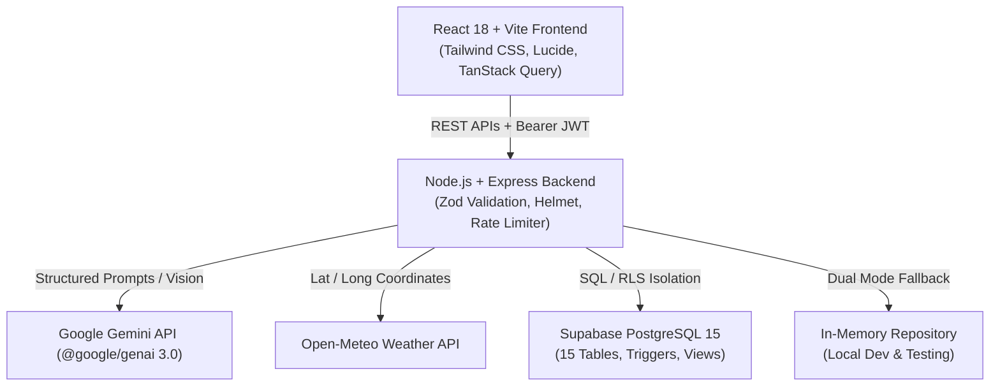

# AgriAssist AI — AI-Powered Agriculture Crop Advisory Assistant

[](#)
[](#)
[](#)
[-orange.svg)](#)

AgriAssist AI is a production-grade, end-to-end digital crop advisory platform that connects farmers with artificial intelligence and agronomic data. The platform provides intelligent crop recommendations, soil fertility analysis, multimodal crop disease and pest diagnosis via image upload, precision fertilizer scheduling, hyper-local meteorological alerts, stage-wise cultivation timelines, and a multilingual agronomic chat assistant.

---

## Table of Contents

- [Core Capabilities](#core-capabilities)
- [Architecture & Tech Stack](#architecture--tech-stack)
- [Project Structure](#project-structure)
- [Getting Started](#getting-started)
  - [Prerequisites](#prerequisites)
  - [Installation](#installation)
  - [Environment Configuration](#environment-configuration)
  - [Database Setup & Migrations](#database-setup--migrations)
  - [Running the Application](#running-the-application)
- [Testing](#testing)
- [API Overview](#api-overview)
- [Database Schema](#database-schema)
- [Security & Compliance](#security--compliance)
- [Agricultural Advisory Disclaimer](#agricultural-advisory-disclaimer)

---

## Core Capabilities

1. **Intelligent Crop Recommendation Engine**
   - Evaluates soil type, pH, N-P-K nutrient status, farm area, irrigation infrastructure, agro-climatic season (Kharif, Rabi, Zaid), and cultivation budget.
   - Generates ranked crop alternatives with suitability scores, expected yield per hectare, cost-benefit estimates, and risk factors.

2. **Soil Health & Fertility Diagnostic**
   - Analyzes soil pH, electrical conductivity (EC), and organic carbon alongside macronutrients (N, P, K) and micronutrients (Zinc, Iron, Boron).
   - Prescribes soil amendments (e.g., agricultural lime for acid soils, gypsum for alkali soils) and organic matter enhancements.

3. **Multimodal Crop Disease & Pest Identification**
   - Supports camera capture and image upload of symptomatic leaves, stems, or fruits.
   - Uses Google Gemini multimodal vision capabilities to identify fungal, bacterial, viral, or pest damage, with confidence levels and organic/chemical remedy recommendations.

4. **Precision Fertilizer & Nutrient Advisory**
   - Calculates basal and split-dose fertilizer requirements (Urea, DAP, MOP, SSP, Micronutrients) tailored to crop growth stages.
   - Prevents nutrient toxicity, runoff, and unnecessary input expenditure.

5. **Hyper-Local Weather & Climate Advisory**
   - Integrates with Open-Meteo API for real-time temperature, humidity, wind velocity, and 7-day precipitation forecasts.
   - Issues rule-based agronomic alerts for rain-induced spray delays, frost warnings, and irrigation timing.

6. **Stage-Wise Cultivation Lifecycle Scheduler**
   - Automatically builds an end-to-end task schedule from seed treatment and land preparation to weeding, top-dressing, and harvesting.
   - Enables task status tracking with visual timeline progress indicators.

7. **Multilingual Agronomic Chat Assistant**
   - Natural language question-and-answering in 9 Indian languages (English, Hindi, Telugu, Tamil, Kannada, Marathi, Bengali, Gujarati, Punjabi).
   - Ingests farm context (soil type, location, active crop) to give hyper-relevant advice.

8. **Role-Based Admin Console & Audit Log**
   - Centralized telemetry metrics on registered farmers, plots, advisories, and system health.
   - Management controls to curate and expand the verified crop catalog.

---

## Architecture & Tech Stack



- **Frontend**: React 18, Vite, Tailwind CSS, TanStack React Query v5, React Router v6, React Hook Form, Lucide React, Axios.
- **Backend**: Node.js 20+, Express.js, Zod v3, Helmet, CORS, Express-Rate-Limit, Multer (in-memory image buffer).
- **AI / LLM Integration**: Official `@google/genai` SDK v3.0, Gemini 2.5 Flash with strict `application/json` schema enforcement.
- **Database & Auth**: Supabase PostgreSQL 15 with Row Level Security (RLS) policies, JWT bearer authentication, and offline fallback memory repository.

---

## Project Structure

```
antigravity/
├── client/                     # React 18 + Vite Frontend
│   ├── src/
│   │   ├── api/                # Axios client and endpoint definitions
│   │   ├── components/         # Reusable modular UI components
│   │   │   ├── chat/           # ChatWindow, ChatMessage
│   │   │   ├── common/         # PageHeader, AlertBanner, LoadingSpinner, EmptyState
│   │   │   ├── crops/          # Recommendation forms & result cards
│   │   │   ├── cultivation/    # Schedule planner & timeline components
│   │   │   ├── dashboard/      # Summary cards, quick action grid
│   │   │   ├── disease/        # Image upload & disease report cards
│   │   │   ├── farms/          # Plot registration & management forms
│   │   │   ├── fertilizer/     # Fertilizer calculation forms & tables
│   │   │   ├── layout/         # AppLayout, AuthLayout, Navbar, Sidebar
│   │   │   ├── soil/           # Soil test input forms & soil health cards
│   │   │   └── weather/        # Weather overview & agricultural alert cards
│   │   ├── constants/          # Indian states/districts, seasons, soil classifications
│   │   ├── context/            # Supabase AuthContext & demo session provider
│   │   ├── pages/              # 26 Complete Application Routes
│   │   │   ├── admin/          # AdminDashboardPage
│   │   │   ├── advisories/     # Crop, Soil, Disease, Fertilizer, Weather pages
│   │   │   ├── auth/           # Login, Register, ForgotPassword, ResetPassword
│   │   │   ├── chat/           # AiAssistantPage
│   │   │   ├── cultivation/    # Plans list, CreatePlan, PlanDetailPage
│   │   │   ├── dashboard/      # DashboardPage
│   │   │   ├── farms/          # FarmsPage, AddFarmPage, FarmDetailsPage
│   │   │   ├── history/        # HistoryPage
│   │   │   ├── notifications/  # NotificationsPage
│   │   │   ├── profile/        # ProfilePage
│   │   │   ├── public/         # Landing, About, Privacy, Terms
│   │   │   └── settings/       # SettingsPage
│   │   ├── App.jsx             # React Router route registry
│   │   ├── index.css           # Tailwind custom styling & scrollbars
│   │   └── main.jsx            # React root with QueryClient & AuthProvider
│   ├── package.json
│   └── vite.config.js
│
├── server/                     # Node.js + Express Backend
│   ├── src/
│   │   ├── config/             # Zod environment validator, Supabase & Gemini SDK clients
│   │   ├── controllers/        # Express handlers (Advisory, Farm, Chat, Admin, etc.)
│   │   ├── middleware/         # Auth, Role Guard, Multer, Rate-limiting, Zod error handler
│   │   ├── prompts/            # Production Gemini system prompt & structured schemas
│   │   ├── repositories/       # Dual-mode Supabase / in-memory repository
│   │   ├── routes/             # REST route endpoints (/api/v1/...)
│   │   ├── services/           # Gemini AI service, Open-Meteo weather service
│   │   ├── utils/              # Structured logger, standardized API response builder
│   │   ├── validators/         # Strict Zod schemas for requests & AI output schemas
│   │   ├── app.js              # Express app initialization
│   │   └── server.js           # Server listen with graceful shutdown
│   ├── tests/
│   │   ├── integration/        # Health, crops, auth & farm CRUD tests
│   │   └── unit/               # Zod validation schema unit tests
│   └── package.json
│
├── supabase/                   # Database migrations & seeds
│   ├── migrations/
│   │   └── 20261106_agri_assist_schema.sql  # 15 tables, RLS policies, triggers
│   └── seed.sql                # 22 Indian crops catalog + reference data
│
└── docs/                       # Architecture & technical documentation
    ├── architecture.md
    ├── api-documentation.md
    ├── database-schema.md
    ├── setup-guide.md
    └── security.md
```

---

## Getting Started

### Prerequisites

- **Node.js**: v20.0.0 or higher
- **npm**: v9.0.0 or higher
- *(Optional)* **Supabase Account**: For production PostgreSQL and Auth
- *(Optional)* **Google Gemini API Key**: For live AI operations (gemini-2.5-flash)

### Installation

Clone the repository and install dependencies for both server and client:

```bash
# 1. Install server dependencies
cd server
npm install

# 2. Install client dependencies
cd ../client
npm install
```

### Environment Configuration

#### Server (`server/.env`):
```env
PORT=5000
NODE_ENV=development

# Google Gemini API
GEMINI_API_KEY=your_gemini_api_key_here

# Supabase Database & Auth (Leave blank for in-memory demo mode)
SUPABASE_URL=https://your-project.supabase.co
SUPABASE_ANON_KEY=your_supabase_anon_key
SUPABASE_SERVICE_ROLE_KEY=your_supabase_service_role_key

# Client CORS
CLIENT_URL=http://localhost:5173
```

#### Client (`client/.env`):
```env
VITE_API_BASE_URL=/api/v1
VITE_SUPABASE_URL=https://your-project.supabase.co
VITE_SUPABASE_ANON_KEY=your_supabase_anon_key
```

### Database Setup & Migrations

If using a real Supabase project:
1. Open your Supabase Dashboard SQL Editor.
2. Run the migration script in `supabase/migrations/20261106_agri_assist_schema.sql`.
3. Run the seed data script in `supabase/seed.sql`.

*Note: If no Supabase credentials are provided in `.env`, the server automatically initializes an in-memory repository pre-loaded with mock farms and the 22 Indian crop catalog so the app works immediately out of the box!*

### Running the Application

Open two terminal windows:

```bash
# Terminal 1: Start Backend Server (runs on http://localhost:5000)
cd server
npm run dev

# Terminal 2: Start Frontend Client (runs on http://localhost:5173)
cd client
npm run dev
```

Visit **http://localhost:5173** in your browser. You can click **"Demo Farmer Login"** or **"Demo Admin Login"** on the login screen to explore the application without setting up credentials.

---

## Testing

Run unit and integration test suites:

```bash
cd server
npm test
```

Test coverage includes:
- Zod schema validation for crop recommendations, soil tests, and farms.
- Server health probes (`/api/v1/health`).
- Unauthenticated vs Authenticated API access guards.
- Farm CRUD operations and user ownership assertions.

---

## API Overview

All API endpoints are prefixed with `/api/v1`:

| Method | Endpoint | Description | Auth Required |
|---|---|---|---|
| `GET` | `/health` | Server uptime & service health | No |
| `GET` | `/crops` | List crop catalog with filters | No |
| `GET` | `/crops/categories` | List crop taxonomic categories | No |
| `GET` | `/profile` | Get authenticated farmer profile | Yes |
| `PATCH` | `/profile` | Update farmer profile & units | Yes |
| `GET` | `/farms` | List user's registered plots | Yes |
| `POST` | `/farms` | Register a new farm plot | Yes |
| `GET` | `/farms/:id` | Get farm plot details | Yes |
| `PATCH` | `/farms/:id` | Update farm plot attributes | Yes |
| `DELETE` | `/farms/:id` | Delete farm plot | Yes |
| `POST` | `/advisories/crop-recommendation` | Generate AI crop recommendations | Yes |
| `POST` | `/advisories/soil-analysis` | Analyze soil test report & fertility | Yes |
| `POST` | `/advisories/disease-detection` | Multimodal crop image diagnosis | Yes |
| `POST` | `/advisories/fertilizer` | Calculate stage-wise fertilizer plan | Yes |
| `GET` | `/weather/current` | Current weather for lat/long | Yes |
| `GET` | `/weather/forecast` | 7-day weather forecast | Yes |
| `GET` | `/weather/agricultural-advisory` | Weather-driven farming rules | Yes |
| `GET` | `/cultivation-plans` | List cultivation schedules | Yes |
| `POST` | `/cultivation-plans` | Generate stage-wise plan | Yes |
| `PATCH` | `/cultivation-plans/tasks/:id` | Update cultivation task status | Yes |
| `GET` | `/chat/conversations` | List agronomic chat sessions | Yes |
| `POST` | `/chat/conversations/:id/messages` | Send message to AI assistant | Yes |
| `GET` | `/history` | Chronological advisory history | Yes |
| `GET` | `/notifications` | Advisory and weather alerts | Yes |
| `GET` | `/admin/dashboard` | Aggregated platform telemetry | Yes (Admin) |
| `POST` | `/admin/crops` | Add verified crop to catalog | Yes (Admin) |

---

## Security & Compliance

- **No Exposed Credentials**: Frontend bundle contains zero AI API keys or Supabase service role keys.
- **Row Level Security (RLS)**: Enforced in PostgreSQL on all user tables; queries are scoped by `auth.uid() = user_id`.
- **Zod Boundaries**: 100% of incoming payloads and Gemini LLM outputs are validated against strict Zod schemas before being processed or persisted.
- **Multimodal File Sanitization**: Multer stores uploaded images strictly in volatile RAM buffer, validating MIME types (`image/jpeg`, `image/png`, `image/webp`) and enforcing an 8MB maximum size.
- **Rate Limiting**: AI endpoints are rate-limited per user/IP to prevent quota exhaustion and abuse.

---

## Agricultural Advisory Disclaimer

> **Important Agricultural Notice**: AgriAssist AI provides educational and advisory insights powered by artificial intelligence and agronomic reference datasets. Environmental factors such as unseasonal microclimate shifts, localized pest vectors, soil heterogeneity, and seed quality variations affect real-world outcomes. Recommendations must be adapted to local conditions in consultation with licensed agricultural extension officers, Krishi Vigyan Kendras (KVK), or state agriculture departments.

# antigravity

# antigravity

# antigravity-project

