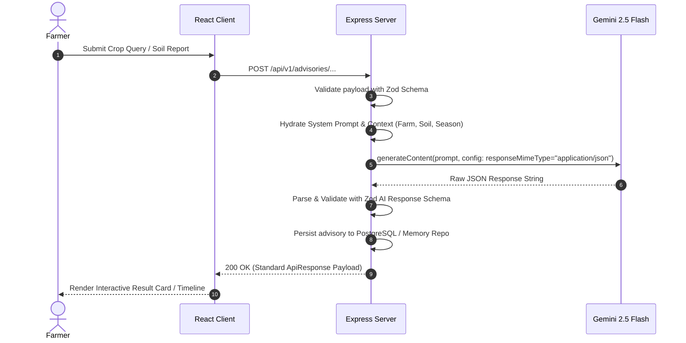

# System Architecture & Technical Design

## 1. Executive Summary

AgriAssist AI is designed as a resilient, modular full-stack agricultural decision support platform. It bridges generative artificial intelligence (Google Gemini 2.5 Flash) with deterministic agronomic rules, geospatial weather telemetry (Open-Meteo), and relational data storage (PostgreSQL via Supabase).

## 2. High-Level Architecture

```mermaid
graph TB
    subgraph ClientLayer ["Client Layer (React 18 + Vite)"]
        UI[Tailwind CSS UI Components]
        Router[React Router DOM v6]
        QueryCache[TanStack React Query Cache]
        AuthCtx[Supabase AuthContext]
    end

    subgraph ServerLayer ["Server Layer (Node.js 20 + Express)"]
        Gateway[Express App + Helmet + CORS + RateLimiter]
        AuthMW[Auth Middleware (JWT / Demo Token)]
        Validators[Zod Request Validators]
        Controllers[Controller Action Handlers]
        
        subgraph Services ["Application Services"]
            GeminiSvc[Gemini AI Service (@google/genai 3.0)]
            WeatherSvc[Open-Meteo Weather Service]
        end

        subgraph DataAccess ["Data Access Layer"]
            Repo[Dual-Mode Repository]
        end
    end

    subgraph StorageLayer ["Persistence & External Services"]
        SupabaseDB[(Supabase PostgreSQL 15 + RLS)]
        MemoryFallback[(In-Memory In-Memory Repo)]
        GeminiAPI[Google Gemini 2.5 Flash API]
        MeteoAPI[Open-Meteo REST API]
    end

    ClientLayer -->|"HTTPS / JSON"| Gateway
    Gateway --> AuthMW --> Validators --> Controllers
    Controllers --> Services
    Controllers --> DataAccess
    GeminiSvc -->|"gRPC / HTTPS"| GeminiAPI
    WeatherSvc -->|"HTTPS"| MeteoAPI
    Repo -->|"pg / Supabase Client"| SupabaseDB
    Repo -.->|"Fallback if unconfigured"| MemoryFallback
```

## 3. Component Architecture

### 3.1 Frontend Architecture
- **State Management**: TanStack React Query v5 manages server state, caching, optimistic mutations, and background refetching. UI state (forms, modal toggles) uses localized React hooks.
- **Routing**: `App.jsx` registers 26 route views separated into public marketing, authentication flows, and protected dashboard layouts wrapped in `<ProtectedRoute>`.
- **Styling & Assets**: Built with Tailwind CSS using an agro-ecology palette (emerald green, forest green, warm soil amber). Lucide React provides scalable iconography.

### 3.2 Backend Service Architecture
- **Fail-Safe Design**: The server boots cleanly even when third-party services (Supabase or Gemini) are unconfigured. The database repository automatically switches to an in-memory storage engine preloaded with 22 Indian crop varieties.
- **Strict Typing via Zod**: Both incoming HTTP request payloads and Gemini LLM JSON responses are passed through Zod schema validators before controller logic executes.
- **Security Middleware**: Includes `helmet` HTTP headers, origin-restricted `cors`, standard and AI-specific rate limiters (`express-rate-limit`), and a memory-only file upload pipeline (`multer`) enforcing 8MB limits and MIME type whitelists.

## 4. Artificial Intelligence & Prompt Pipeline



## 5. Resiliency & Fallback Strategy

1. **AI Service Outage**: If the Gemini API experiences rate limits, timeouts, or network errors, the `gemini.service.js` executes exponential backoff retries. If unreachable, the advisory controller gracefully falls back to deterministic rule-based agronomic guidelines based on Indian agricultural university standards.
2. **Database Connectivity**: If Supabase credentials are missing or database connection drops, the dual-mode repository maintains transactional state in RAM, allowing testing and evaluation to continue uninterrupted.
3. **Weather Telemetry**: Open-Meteo provides keyless forecasts. If coordinates are unavailable, regional defaults based on the user's selected state/district are used.

