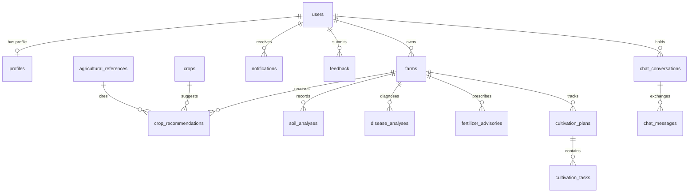

# Database Schema & Entity-Relationship Architecture

AgriAssist AI uses PostgreSQL 15 managed via Supabase. All tables enforce strict schema constraints, foreign key cascades, check constraints, automatic timestamps, and PostgreSQL Row Level Security (RLS) policies.

---

## 1. Entity-Relationship Diagram



---

## 2. Table Specifications

### 2.1 Core Identity & Profiles

| Table | Description | Key Columns |
|---|---|---|
| `profiles` | Extended farmer demographics, language, and metric preferences | `user_id` (FK to auth.users, PK), `full_name`, `phone`, `state`, `district`, `village`, `farming_experience`, `preferred_language`, `preferred_unit` |
| `audit_logs` | Immutable audit log of administrative and system events | `id`, `user_id`, `action`, `entity`, `entity_id`, `payload`, `ip_address`, `created_at` |

### 2.2 Farm & Agricultural Taxonomy

| Table | Description | Key Columns |
|---|---|---|
| `farms` | Farmer's physical land holdings | `id`, `user_id`, `farm_name`, `state`, `district`, `village`, `total_area`, `area_unit`, `soil_type`, `irrigation_type`, `water_availability`, `current_crop` |
| `crops` | Catalog of 22 Indian crop varieties with agronomic requirements | `id`, `name`, `scientific_name`, `category`, `season`, `optimal_ph_min`, `optimal_ph_max`, `water_requirement`, `duration_days_min`, `duration_days_max`, `expected_yield_per_hectare` |
| `agricultural_references` | Verified university, ICAR, and KVK research sources | `id`, `title`, `author_institution`, `publication_year`, `url`, `category` |

### 2.3 Advisory Records

| Table | Description | Key Columns |
|---|---|---|
| `crop_recommendations` | AI-generated crop suitability reports | `id`, `user_id`, `farm_id`, `season`, `soil_type`, `ph_level`, `recommendations` (JSONB), `ai_model`, `created_at` |
| `soil_analyses` | Chemical and physical soil fertility tests | `id`, `user_id`, `farm_id`, `ph`, `ec`, `organic_carbon`, `nitrogen_kg_ha`, `phosphorus_kg_ha`, `potassium_kg_ha`, `deficiencies` (JSONB), `recommendations` (JSONB) |
| `disease_analyses` | Pathogen, fungus, and pest diagnosis logs | `id`, `user_id`, `farm_id`, `crop_name`, `image_url`, `symptoms`, `diagnosis_name`, `confidence_score`, `treatment_plan` (JSONB) |
| `fertilizer_advisories` | Stage-wise N-P-K nutrient schedules | `id`, `user_id`, `farm_id`, `crop_name`, `target_yield`, `schedule` (JSONB), `organic_alternatives` (JSONB) |

### 2.4 Cultivation Planning & Task Execution

| Table | Description | Key Columns |
|---|---|---|
| `cultivation_plans` | Active agricultural production schedules | `id`, `user_id`, `farm_id`, `crop_name`, `sowing_date`, `expected_harvest_date`, `status`, `timeline` (JSONB) |
| `cultivation_tasks` | Individual actionable tasks per stage | `id`, `plan_id`, `user_id`, `phase`, `task_name`, `description`, `due_date`, `status` (`pending`, `completed`), `priority` |

### 2.5 Chat & Notifications

| Table | Description | Key Columns |
|---|---|---|
| `chat_conversations` | Multilingual dialogue sessions | `id`, `user_id`, `farm_id`, `title`, `created_at`, `updated_at` |
| `chat_messages` | Individual message turns with AI metadata | `id`, `conversation_id`, `role` (`user`, `assistant`), `content`, `language`, `metadata` (JSONB) |
| `notifications` | Weather alerts and cultivation task reminders | `id`, `user_id`, `title`, `message`, `type`, `action_url`, `is_read`, `created_at` |
| `feedback` | Farmer satisfaction ratings on AI advisories | `id`, `user_id`, `advisory_type`, `advisory_id`, `rating`, `comments` |

---

## 3. Row Level Security (RLS) Isolation

Every table containing user-specific data has RLS enabled with isolation policies:

```sql
-- Example RLS Policy for farms
ALTER TABLE farms ENABLE ROW LEVEL SECURITY;

CREATE POLICY "Users can only read own farms"
ON farms FOR SELECT
USING (auth.uid() = user_id);

CREATE POLICY "Users can only insert own farms"
ON farms FOR INSERT
WITH CHECK (auth.uid() = user_id);

CREATE POLICY "Users can only update own farms"
ON farms FOR UPDATE
USING (auth.uid() = user_id);

CREATE POLICY "Users can only delete own farms"
ON farms FOR DELETE
USING (auth.uid() = user_id);
```

Public reference tables like `crops` and `agricultural_references` allow read access to all authenticated users, while write operations are restricted to administrators via the `is_admin()` security definer function.

